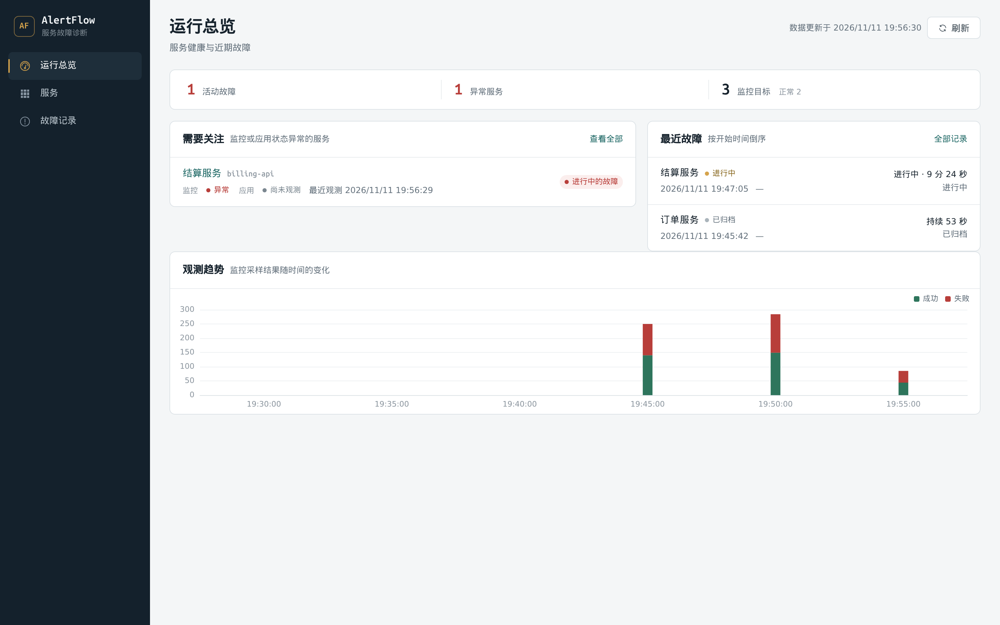
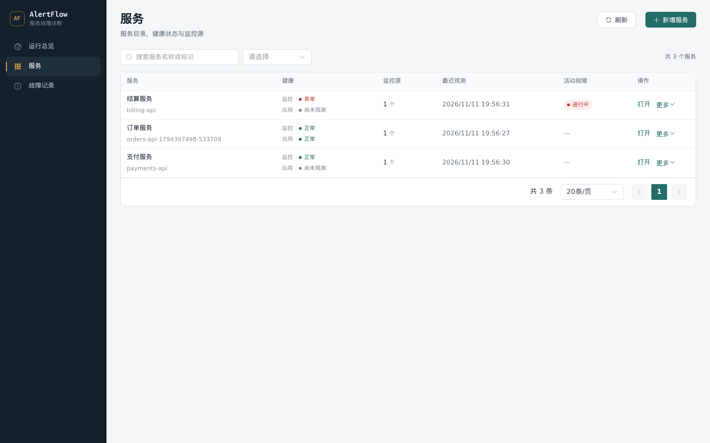
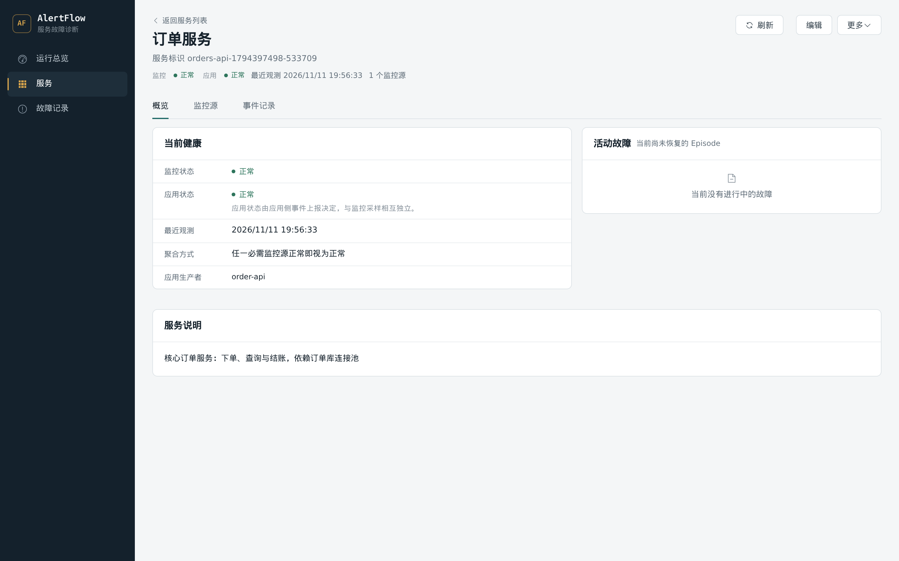
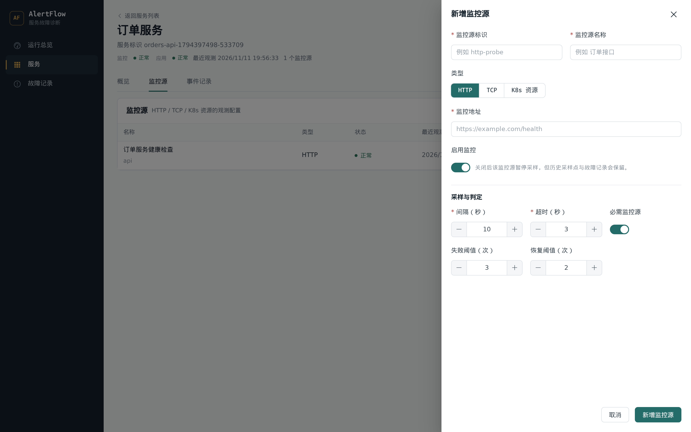
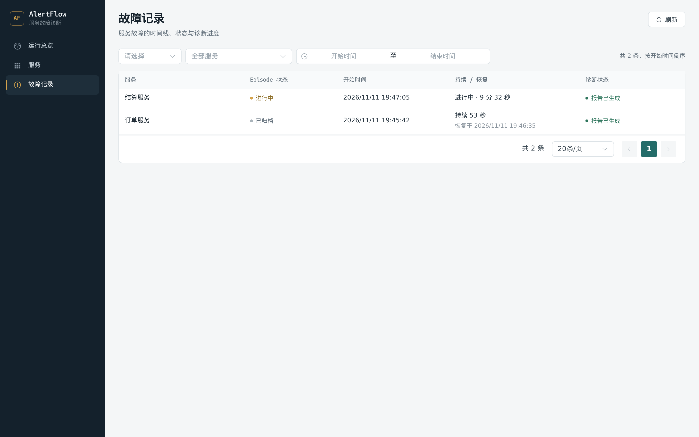
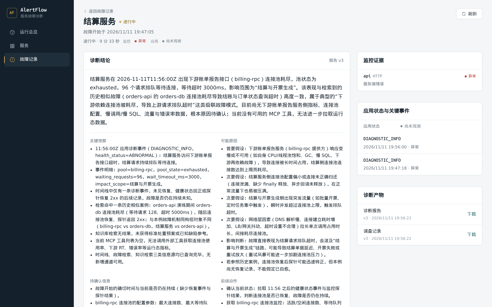
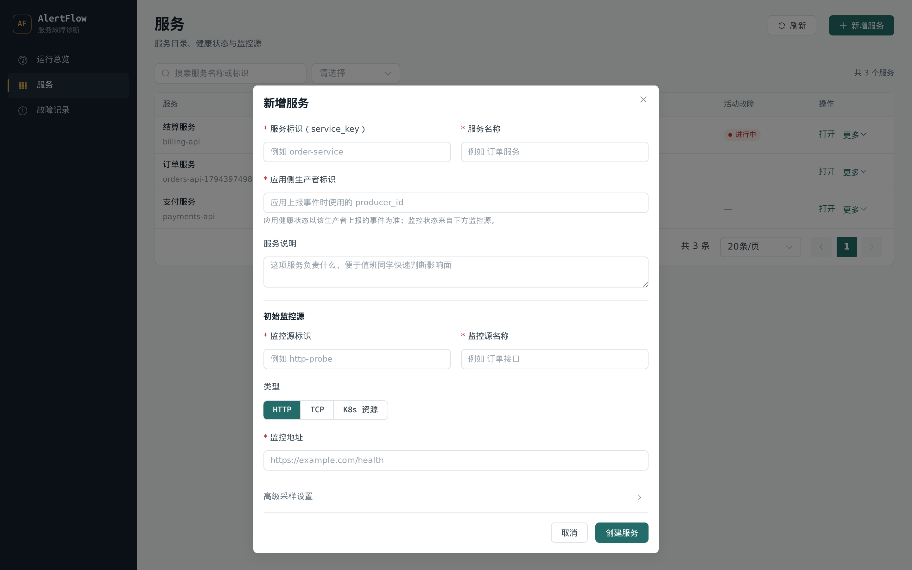

<div align="center">

# Alert

**面向服务故障的监控、调查与可追溯诊断系统**

探测发现异常 → 自动立案 → AI Agent 调查诊断 → 产物沉淀 → 知识复用

`Go` · `Python` · `Vue` · `gRPC` · `PostgreSQL` · `Kafka`

</div>

---

## 为什么是 Alert

传统告警系统止步于"发现问题"：值班人员收到告警后，还要人工翻日志、查监控、回忆历史故障。**Alert 把这条调查链路自动化了**——

- 系统对服务目标持续执行 HTTP/TCP 探测，阈值聚合后自动立案；
- 立案即派发任务：AI 诊断 Agent 在**冻结的输入边界**内独立调查，产出带版本号的调查记录与诊断报告，绝不编造结论；
- 每一次诊断都会沉淀为可检索的故障知识，下一次同类故障，Agent 检索历史即可给出更快、更有依据的判断。

## 工作原理

1. **探测与立案** —— worker 对目标执行探测，阈值聚合触发故障事件（episode）。
2. **任务派发** —— 控制面经 gRPC 下发诊断/归档任务，携带冻结输入范围与截止时间；心跳与租约保证不双执行。
3. **诊断调查** —— 诊断 Agent 循环执行：拉时间轴 → 检索历史故障 → 咨询知识库 → 调用 MCP 工具 → 提交报告；预算耗尽时显式给出"未完成"结论。
4. **产物沉淀** —— 调查记录（Markdown）与诊断报告（JSON）版本化落盘，登记回控制面，正文随时可读。
5. **知识复用** —— 归档任务提取故障索引入库；RAG 检索让历史经验直接服务下一次诊断。

## 界面预览

Vue 控制台覆盖从服务管理到故障调查的完整操作面：

|  |  |
|:---:|:---:|
| **运行总览** | **服务目录** |
|  |  |
| **服务详情** | **探测目标配置** |
|  |  |
| **告警事件列表** | **故障详情** |
|  |  |
| **AI 调查记录** | **服务创建** |

## 快速开始

```bash
# 1. 依赖拓扑（PG 需 pgvector 扩展，compose 已配置）
docker compose -f deploy/compose/compose.yaml up -d

# 2. 控制面（Go）
cd services/system-core
go run ./cmd/api -migrate          # 首次迁移（system schema）
go run ./cmd/api                   # REST 进程
go run ./cmd/worker                # 后台进程（探测 / 派发 / 消费）

# 3. 认知执行栈（Python）
cd ../agent-runtime
cp .env.example .env               # 按需修改数据库与 LLM 端点
.venv/bin/python -m alert_agent.bootstrap.migrate   # 首次迁移（cognitive schema）
.venv/bin/python -m alert_agent.bootstrap.app       # 网关 + 双 Agent + worker 一体进程
```

构建验证：`go build ./... && go vet ./...`（Go）；`.venv/bin/ruff check src eval tests`（Python）。

## 核心特性

- 🤖 **受约束的诊断 Agent** —— langgraph 循环 + 动作判别联合，每一步可追溯；预算（轮次/调用/时长）统一熔断，耗尽即显式"未完成"，模型幻觉无处藏身。
- 🔍 **双腿检索问答** —— pgvector 向量 + BM25 双腿、RRF 融合、可降级重排；`POST /chat` 真流式 SSE，引用编号可溯、答案与引用强校验。
- 📦 **产物与知识双沉淀** —— 调查过程版本化落盘（`storage_key` 地址制），诊断结论提炼为故障索引，跨事件复用。
- 🔒 **边界与安全内建** —— 任务围栏（fence）防旧代次写入、路径穿越与 SSRF 拒绝、内部 token 常量时间比较、日志脱敏。
- 🔌 **协议面开放** —— gRPC 任务通道（SubmitTask + 7 类回调）、MCP Streamable-HTTP 长会话、A2A AgentCard 与 message/send。

## 目录导航

| 目录 | 内容 |
|---|---|
| `services/system-core/` | Go 控制面（api + worker 双入口、六层结构） |
| `services/agent-runtime/` | Python 认知执行栈（五层骨架 + 迁移 + eval） |
| `apps/console/` | Vue 控制台 |
| `contracts/` | proto 与事件 Schema（语言无关契约源） |
| `docs/` | 架构说明、操作手册、验收记录、界面截图 |
| `deploy/compose/` | 本地依赖拓扑（pgvector 版 PG + Kafka KRaft） |

## 测试与验收

```bash
cd services/system-core && go build ./... && go vet ./... && go test ./internal/domain/... ./internal/contracts/...
cd services/agent-runtime && .venv/bin/ruff check src eval tests && .venv/bin/pytest tests -q
```

离线检索评测（可选）：`services/agent-runtime/eval/run.py`，用法见该目录说明。

## 已知限制

1. 仅面向本地 / 可信内网演示：控制台与认知面未接入终端用户鉴权。
2. 无 K8s 编排与微服务拆分：Go 为单 module 双进程，Python 为单进程一体栈。
3. 诊断与向量检索依赖外部 LLM / Embedding 端点；未配置时相关能力显式不可用（配置校验 fail-fast），其余链路可独立运行。

## 相关文档

- [架构说明](docs/architecture/overview.md) · [数据所有权](docs/architecture/data-ownership.md)
- [构建](docs/runbooks/build.md) · [本地运行](docs/runbooks/run-local.md) · [迁移](docs/runbooks/migrate.md) · [冒烟](docs/runbooks/smoke.md)
- [认知执行栈说明](services/agent-runtime/README.md)